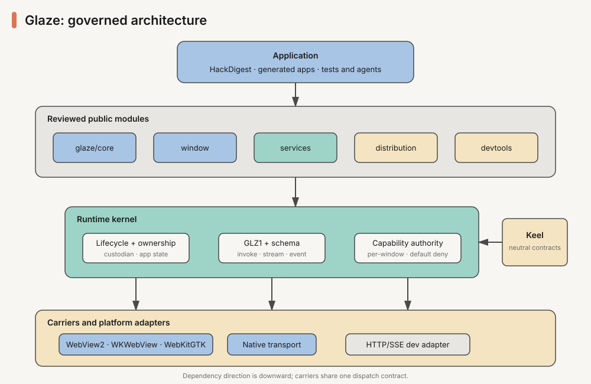

# Glaze architecture

> Glaze is a GUI-first Racket application framework whose production boundary is a native WebView message channel, with HTTP retained only as an explicit development adapter.

## Product and trust boundary

A Glaze application keeps business logic and privileged capabilities in Racket while rendering its interface with HTML, CSS, and JavaScript inside the operating system WebView. Windows uses WebView2, macOS uses WKWebView, and Linux uses WebKitGTK.

The approved production shape is `run-app #:transport 'native`. Frontend resources come from a controlled application origin and commands travel through the GLZ1 message handler. The page does not receive a loopback TCP port or an API token. Each window owns a transport identity and capability authority. During the 0.x compatibility window, `run-app` still defaults to `http`; packaged products must opt into native transport until the 1.0 gate changes that default. HTTP/SSE remains valuable for hot reload, curl, isolated tests, and migration, but it is not the long-term packaged security boundary.



The framework is intentionally GUI-first. Failure to initialize the native WebView is fatal and actionable; opening an external browser is never an application fallback. Optional services such as tray integration may degrade when their platform backend is absent, but that rule does not apply to the main window.

## Runtime ownership

`run-app` owns an application custodian and the lifecycle `starting → ready → running → stopping → stopped`. The application creates windows and transports under that ownership tree. Every thread, stream, timer, subprocess, database handle, and platform callback introduced by a framework service must have an explicit owner and deterministic shutdown path.

GLZ1 is the logical protocol independently of its carrier. It owns hello negotiation, request IDs, invoke/cancel, typed outcomes and errors, sequenced events, streaming frames, payload limits, and per-window authority. The native transport and HTTP adapter must call the same dispatch core; a carrier-specific code path must not reinterpret command semantics.

Keel supplies the transport-neutral lifecycle, schema, type, and structured-error vocabulary. Glaze owns the WebView carrier, JSON-compatible value policy, route declaration syntax, frontend bindings, capability enforcement, resource delivery, and platform window lifecycle. Glaze must not depend on Rivet, and Rivet must not depend on Glaze.

## Module boundaries

The intended public dependency direction is:

```text
application
  └─ glaze/core + one or more reviewed layer modules
       ├─ glaze/window
       ├─ glaze/services
       ├─ glaze/distribution
       └─ glaze/devtools
            ↓
       runtime kernel and capability authority
            ↓
       GLZ1/schema/resource dispatch
            ↓
       platform backends and development adapters
```

The rules are:

- Applications should start with `glaze/core`; importing `glaze` is a supported legacy path, not the model for new code.
- Aggregation modules may depend on implementation modules, but implementation modules must not depend on aggregation modules.
- Platform dispatchers define one backend contract. Platform implementations may not leak OS-specific handles or helpers into `glaze/core`.
- Services may depend on the route, capability, lifecycle, and error contracts. The runtime kernel must not depend on optional services.
- Distribution code may inspect platform metadata and package resources, but packaging policy must not alter runtime semantics.
- New implementation-only modules belong under `glaze/private/` unless they are deliberately assigned to a documented public tier.
- `glaze/experimental` is a quarantine, not a shortcut around design review. Graduation requires real product use, tests, documentation, and one release cycle without contract churn.

The current repository predates these physical boundaries, so several large files still mix orchestration and mechanisms. Moving code is a characterization-first migration: preserve behavior with focused tests, extract one responsibility, run the full suite, and keep the original public import path as a shim until the planned compatibility window closes.

Current physical owners are:

| Responsibility | Owner | Aggregation/compatibility path |
|---|---|---|
| CLI dispatch | `glaze-cli/cli.rkt` | executable entry only |
| CLI commands and project/schema configuration | `glaze-cli/private/` | dispatched by `glaze-cli/cli.rkt` |
| HTTP trust policy | `glaze/private/http-security.rkt` | `glaze/server.rkt` |
| Static-resource and native-origin policy | `glaze/private/native-resources.rkt` | `glaze/native-transport.rkt` and HTTP adapter |
| Native browser bootstrap/client generation | `glaze/private/native-client.rkt` | `glaze/native-transport.rkt` |
| GLZ1 envelope, typed invoke, capability, timeout, hello, and cancel dispatch | `glaze/private/bridge-dispatch.rkt` | re-exported by `glaze/native-transport.rkt`; used directly by HTTP |
| Native session, streams, and delivery | `glaze/native-transport.rkt` | public compatibility owner; further G2 boundary work remains |
| Build entry generation | `glaze/private/build-entry.rkt` | `glaze/build.rkt` |
| Linux, macOS, and Windows package metadata | `glaze/private/*-package-metadata.rkt`, `glaze/private/macos-bundle-metadata.rkt`, and `glaze/private/windows-installer-metadata.rkt` | `glaze/build.rkt` |
| Build graph, staging, signing, and notarization | `glaze/build.rkt` | public compatibility owner; further G2 boundary work remains |

The CLI is the first completed physical boundary. `glaze-cli/cli.rkt` is a
small executable dispatcher; implementations live under `glaze-cli/private/`
and separately own scaffold generation, native run/verification, distribution
options, update signing, project metadata, and schema governance.
Private command modules may depend on framework capabilities and narrower
private helpers, but a boundary test rejects imports back into the dispatcher,
`inspect`, or `pkg` aggregators.

The same rule now applies to runtime and delivery code. Security decisions,
resource containment, generated native client artifacts, generated build
entries, and platform package metadata have direct private-module tests. The
large public owners retain orchestration and re-export compatibility while the
remaining lifecycle-sensitive work is split in later bounded slices.

HTTP and native carriers now import the same `bridge-dispatch.rkt` owner
directly. It alone converts a GLZ1 envelope into route lookup, typed argument
and result validation, capability authorization, timeout/cancellation, and a
terminal envelope or pass-through response. `server.rkt` no longer imports the
native carrier aggregation module to obtain command semantics.

## Compatibility and consumers

There are two distinct contracts:

- Framework API: Racket module exports and their behavior, governed by `docs/api-stability.md` and the exact export test.
- Application API: a product's typed route schema consumed by its frontend, governed by a checked-in schema baseline and compatibility check.

HackDigest is the first release canary. Its backend and TypeScript bridge exercise typed routes, native streaming, window state, single-instance behavior, explicit browser opening, packaging, and signed updates. A Glaze change is not complete merely because framework tests pass: changes to these paths require HackDigest contract tests and at least one packaged native smoke on every affected platform.

## Change protocol

Every architecture-affecting change follows this order:

1. State the invariant and failure mode in an ADR or the active plan.
2. Add characterization evidence around the current behavior.
3. Change one boundary without combining feature work.
4. Run narrow tests, the full Glaze suite, and affected consumer tests.
5. Update the API/schema baseline only when the change is intentional.
6. Record the result and next handoff in `docs/1.0-plan.md`.

Large rewrites, simultaneous cross-platform edits, and mechanical directory moves without characterization are rejected even when the target layout looks cleaner.
